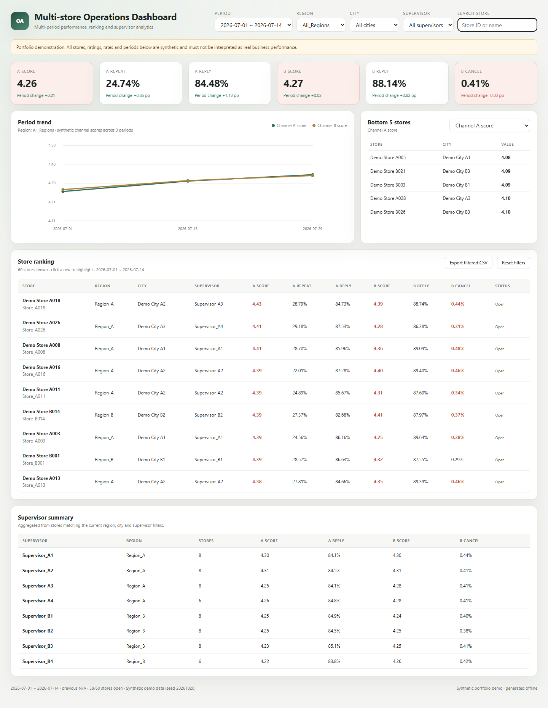
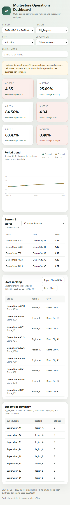

# Multi-store Operations Dashboard

[](https://github.com/suih29993-cmd/multi-store-operations-dashboard/actions/workflows/ci.yml)

`Python 3.11+` · `Synthetic data` · `No third-party frontend libraries`

An offline, self-contained operations dashboard for multi-store performance analysis. The public version uses fully synthetic data and is designed to demonstrate data validation, metric derivation, aggregation, responsive visualization and local deployment.

> **Data notice:** every store, city, supervisor, score and rate in this repository is fictional and generated from a fixed seed. No production dataset, internal report, customer record or company account is required. The numbers are not real business results.



<details>
<summary>Mobile preview</summary>

<p align="center">
  
</p>
</details>

Screenshots use the committed synthetic dataset.

## At a glance

- Three synthetic reporting periods with 60 stores per period and period-over-period deltas.
- Two synthetic regions, six demo cities and eight supervisors.
- Six KPI cards, an inline SVG trend chart, sortable ranking, Bottom-5 analysis and CSV export.
- Five unit tests; CI regenerates inputs, validates the payload, runs tests and rebuilds the page.

## Features

- Three synthetic reporting periods with period-over-period changes.
- Region, city, supervisor and store-search filters.
- KPI cards for two synthetic channels.
- Trend chart rendered as inline SVG without third-party libraries.
- Store ranking with sortable metrics and synthetic risk highlighting.
- Bottom-5 analysis by selected metric.
- Supervisor aggregation and filtered CSV export.
- Standalone HTML output and a small local rebuild server.
- Included `data.json` and `dashboard.html` artifacts for immediate preview.

## Technical implementation

- `scripts/generate_demo_inputs.py`: deterministic synthetic CSV generator.
- `build_data.py`: schema checks, numeric validation, metric derivation, aggregation and `data.json` output.
- `generate_html.py`: injects the validated payload into a self-contained responsive page.
- `server.py`: local static server with file-change rebuilds and a health endpoint.

The two channel names and every metric key are intentionally generic (`channel_a_*` / `channel_b_*`). No vendor-specific naming, account, store identity or production value is included.

## Quick start

```powershell
python scripts/generate_demo_inputs.py
python build_data.py
python generate_html.py
python server.py
```

Open `http://127.0.0.1:8000` if the browser does not open automatically. You can also open the included `dashboard.html` directly because the page is self-contained and embeds only the synthetic payload.

The generator is deterministic. Re-running the commands reproduces the same synthetic stores and metrics without any external file or account.

## Validation

```powershell
python -m unittest discover -s tests -v
python build_data.py --check
```

## Data model

Each store record contains:

- Fictional identity: `Store_A001` / `Store_B001`, region, city, supervisor.
- Two synthetic channel scores and supporting satisfaction, repeat, reply and cancellation indicators.
- Current value, previous value and period delta for every metric.

Aggregations are produced for all regions, each region, each supervisor and each city. All values are deterministic for the included seed.

Regional, city and supervisor summaries use unweighted arithmetic means of the store-level values. This keeps the demo easy to audit; a production implementation would normally choose weightings explicitly.

## Deployment

`netlify.toml` and `wrangler.jsonc` describe a static build. See `docs/DEPLOYMENT.md`. No credentials are required for the demo.

## Scope and limitations

This repository demonstrates an analytics and visualization workflow, not a production data platform. It does not include authentication, multi-tenant access control, a production database or vendor integrations. The risk thresholds are illustrative examples, not confidential operating rules. The included logo is a neutral placeholder, not a company brand asset.

## Isolation and safety

- Every bundled input, generated file and server route resolves from this project directory; no original project path, shared drive or sibling directory is referenced.
- The workflow reads only `demo_input/*.csv` and the committed synthetic `data.json`/`dashboard.html`. It does not inspect other repositories or local business files.
- `server.py` listens on `127.0.0.1` only and rejects paths outside this project. The page contains no API client, remote script, remote font, analytics beacon or vendor integration.
- Runtime output stays in this directory (`demo_input/`, `data.json`, `dashboard.html`, optional `public/` and Python cache files). Generated directories and caches are ignored by Git.
- Dependencies are limited to the Python standard library. Netlify and Cloudflare configurations are optional static-hosting examples and contain no credentials.
